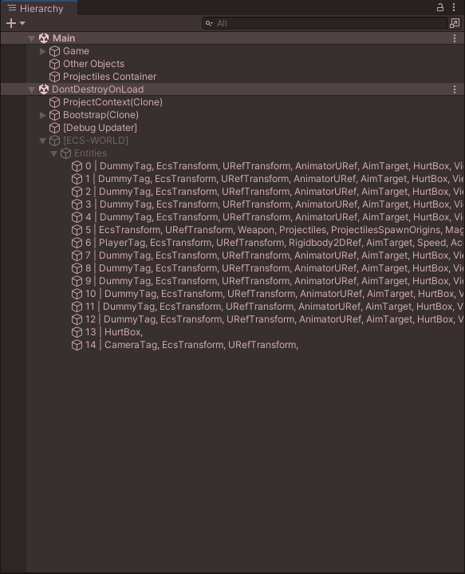
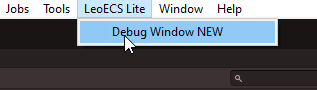
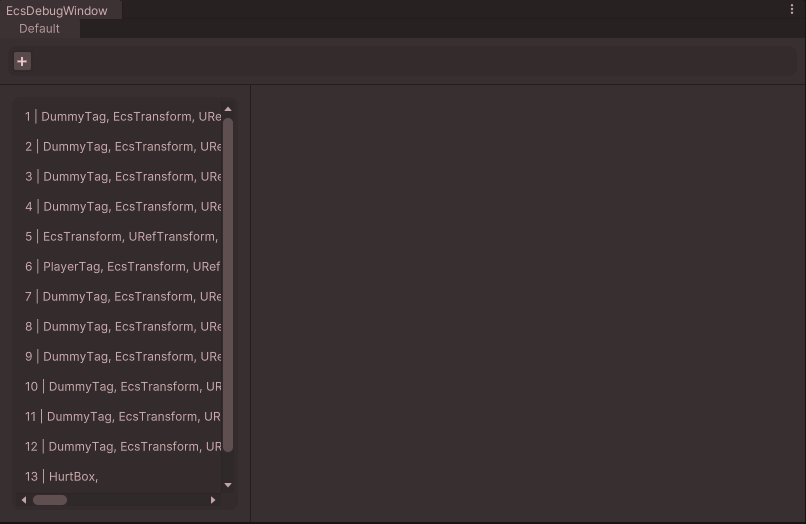
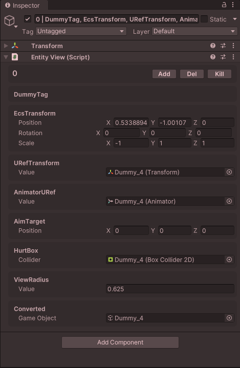
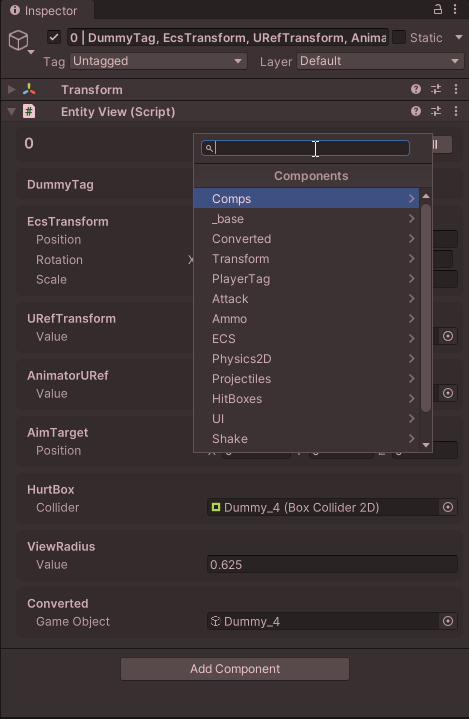
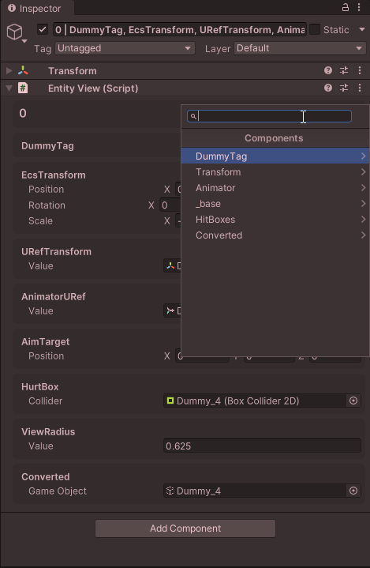
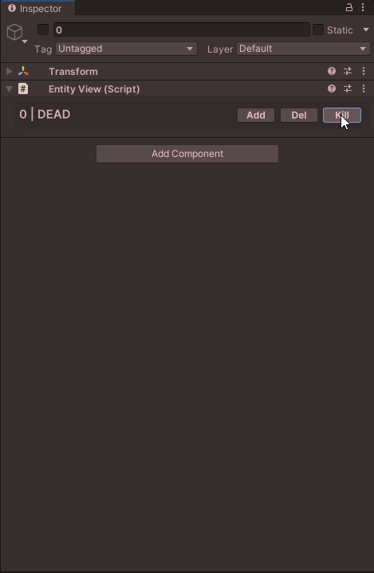
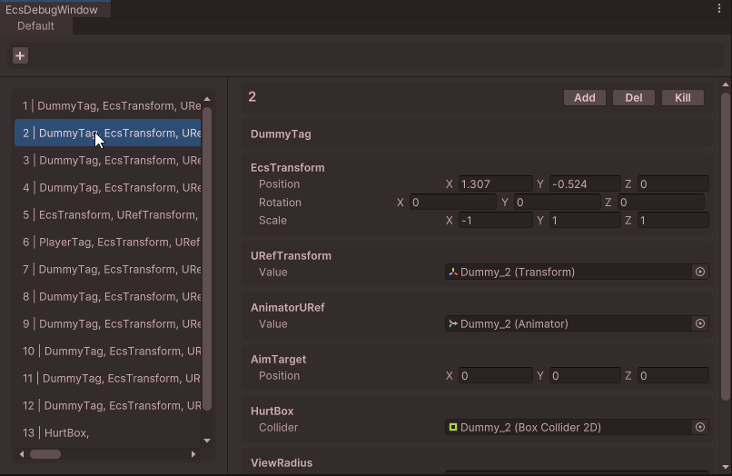
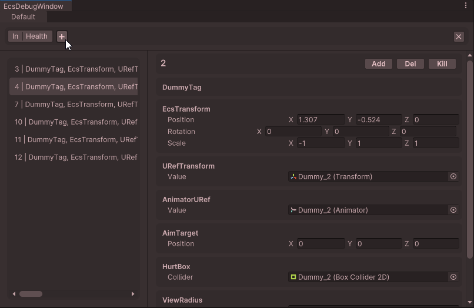

# Unity Editor integration for LeoECS Lite
Unity Editor integration with world-state monitoring \
(does not include [conversion / creation through the inspector](https://github.com/Mitfart/LeoECSLite.UniLeo))

> Tested on Unity ***2021.3 LTS*** (depends on Unity) 


# Contents
* [Installation](#Установка)
  * [As a Unity module](#В-виде-Unity-модуля)
  * [As source code](#В-виде-исходников)
* [Integration](#Интеграция)
  * [Connecting the system](#Подключение-системы)
  * [Declaring a component](#Объявление-компенента)
  * [Viewing](#Просмотр)
* [Capabilities](#Возможности)
* [Feedback](#Обратная-связь)
* [Good practices](#Good-practices)
* [Questions and answers](#Вопросы-ответы)


# Installation

> **IMPORTANT!** Depends on [LeoECS Lite](https://github.com/Leopotam/ecslite)
- `the framework must be installed before this extension`

### As a Unity module
##### Via Package manager:
- Open Package manager
- Click the plus in the top-left corner
- Select "Add from git url" and paste:

```
https://github.com/Mitfart/LeoECSLite.UnityIntegration.git
```

##### or by adding to *@/Packages/manifest.json*:
```
"com.mitfart.leoecslite.unity-integration": "https://github.com/Mitfart/LeoECSLite.UnityIntegration.git",
```

### As source code
The code can also be cloned or downloaded as an archive


# Integration

### Connecting the system
```c#
// ecs-startup code:
IEcsSystems _systems;

void Start() {        
    _systems = new EcsSystems (new EcsWorld());
    _systems
        .Add (new TestSystem1())
#if UNITY_EDITOR
        // Регистрируем отладочные системы по контролю за состоянием каждого отдельного мира:
        // .Add (new Mitfart.LeoECSLite.UnityIntegration.EcsWorldDebugSystem("events"))
        .Add(new Mitfart.LeoECSLite.UnityIntegration.EcsWorldDebugSystem())
        // Для коректного отображения данных, системы необходимо подключать в конце
#endif
        .Init();
}

void Update() {
    // Отладочные системы являюся обычными ECS-системами и для их корректной работы
    // требуется выполнять их запуск через EcsSystems.Run()
    _systems?.Run();
}
```
> **IMPORTANT!** By default, component names are **NOT** written into the name
> (as in `Leopotam`'s system)
> If this behavior is needed, it
> can be added by creating a settings preset for the system
> ```cs
> var nameSettings = new EntityNameSettings(bakeComponents: true);
> ...
> .Add(new Mitfart.LeoECSLite.UnityIntegration.EcsWorldDebugSystem(null, nameSettings))
> ...
> ```

### Declaring a component

```c#
[Serializable] // <-- Для отображения данных компонент долже быть сериализован
public struct Comp {
    public string value;
}
```


# Viewing
Two methods can be used for viewing:
- Classic / direct viewing \


- Using a special window:
> It can be opened **from the top menu** \
> **LeoEcs Lite -> Debug Window**




### Entity


##### "Add" button - ``add component``


##### "Del" button - ``remove component`` 


##### "Kill" button - ``remove / kill entity``


##### In the special window


### Filtering



# Capabilities
+ Fully automatic display of components in the inspector
+ Adding/removing components through the inspector `(at runtime)`
+ Removing an `Entity`
+ Extending `View component` logic using a [custom Editor](https://discord.gg/5GZVde6)
+ [Entity filtering](#Фильтрация) `(in the special window / by object name)`

### Planned
+ You can [suggest](#Обратная-связь)


# Feedback
#### Discord [LeoEcsLite group](https://discord.gg/5GZVde6)
#### Telegram [Ecs group](https://t.me/ecschat)
```
@Mitfart
```


# Good practices
+ Using the [special window](#В редакторе)
+ Disabling component baking into the entity name `(if not needed)`
+ Collapsing the `Entity` list in the hierarchy
+ Using **EITHER** the special window **OR** the hierarchy \
  `(Using both consumes twice as many resources)`


# Questions and answers

### When renaming / changing a type namespace, the component "breaks"
**Solution:** Add the [MovedFrom](https://github.com/Unity-Technologies/UnityCsReference/blob/master/Runtime/Export/Scripting/APIUpdating/UpdatedFromAttribute.cs) attribute \
`after "fixing" it, the attribute can be removed`
```cs
[MovedFrom(
   autoUpdateAPI: false, 
   sourceNamespace: "OldNamespace", // null, if you don't change it
   sourceAssembly: "OldAssembly",   // null, if you don't change it
   sourceClassName: "OldName"       // null, if you don't change it
)]
public struct Comp { ... }
```

### I want to create entities in `IEcsPreInitSystem`, but the debug systems throw exceptions in this case. How do I fix this??

**Cause:** `EcsWorldDebugSystem` is also an `IEcsPreInitSystem`, and a conflict occurs due to system order. \
**Solution 1:** - use `IEcsInitSystem` instead of `IEcsPreInitSystem` \
**Solution 2:** - move all debug systems into a separate `IEcsSystems` and 
call its initialization before the main code:
```c#
IEcsSystems _systems;
#if UNITY_EDITOR
IEcsSystems _editorSystems;
#endif


void Awake() {
    _systems = new EcsSystems (new EcsWorld());
    
#if UNITY_EDITOR
    // Создаем отдельную группу для отладочных систем.
    _editorSystems = new EcsSystems (_systems.GetWorld());
    _editorSystems
      .Add(new LeoECSLite.UnityIntegration.EcsWorldDebugSystem(null, nameSettings))
      .Init ();
#endif

  _systems
    .Add (new Sys())
    .Init();
  }
}


void Update() {
    _systems?.Run();
    
#if UNITY_EDITOR
    // Выполняем обновление состояния отладочных систем. 
    _editorSystems?.Run ();
#endif
}
    
    
void OnDestroy () {
#if UNITY_EDITOR
  // Выполняем очистку отладочных систем.
  if (_editorSystems != null) {
      _editorSystems.Destroy ();
      _editorSystems = null;
  }
#endif
  if (_systems != null) {
      _systems.Destroy();
      _systems.GetWorld().Destroy();
      _systems = null;
  }
}
```

### I want to add my own logic for a component in the inspector window. How can I do that?

By writing your own `Editor / PropertyDrawer` for the component:

In the standard editor: ```@/Editor/Component/ComponentEditor.cs``` \
[UIToolkit](https://docs.unity3d.com/Manual/UIE-HowTo-CreateCustomInspector) is used \
`using standard GUILayout is possible, but not recommended`

```c#
#if UNITY_EDITOR
using UnityEditor;
using UnityEditor.UIElements;
using UnityEngine.UIElements;
using Mitfart.LeoECSLite.UnityIntegration;

[CustomEditor(typeof(ComponentData<Comp>))] 
public class ComponentDataEditor : Editor {
  public override VisualElement CreateInspectorGUI() {
    // Создание главного/родительского элемента
    var container = new VisualElement();
    // ...
    return container;
  }
}
#endif
```
